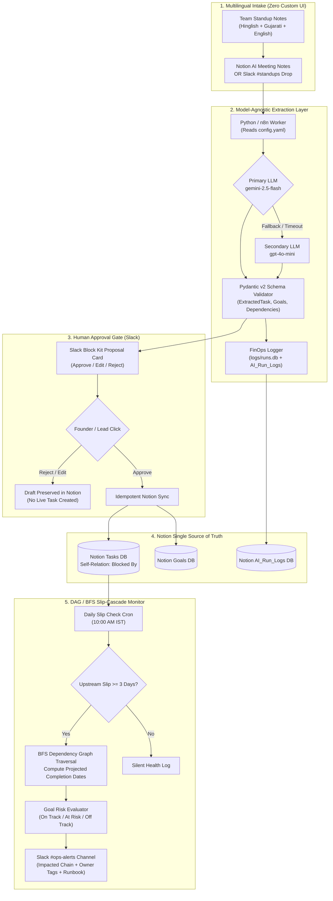

# Just Sortd — PRD 1: Ops Brain Build Plan (1-Page)

> **Role:** Product Engineer, AI & Automation  
> **Target:** Autonomous Operations Brain for Pre-Launch Indian D2C Brand (5–10 team members + vendors)  
> **Core Principle:** Leverage over lines of code. Notion is the single source of truth; Slack is the human approval & alert gate.

---

## 1. What v1 Ships First and Why

**v1 Scope:** 
A lean, high-leverage 3-stage loop:
1. **Multilingual Meeting Intake:** Ingest messy team standups (English + Hindi + Gujarati) via Notion AI Meeting Notes or Slack drop.
2. **Slack Human Approval Gate:** Propose structured tasks via Slack Block Kit (Approve / Edit / Reject). AI *never* silently writes or modifies tasks.
3. **Notion Sync & Daily DAG Slip Cascade Check:** Write approved tasks to Notion with explicit dependencies (`Blocked By`). Run a daily 10:00 AM IST check: if an upstream task slips by **≥ 3 days**, BFS-traverse the dependency graph, flag impacted downstream dates, and ping `#ops-alerts`.

**Why this first:**
The #1 failure mode in fast-growing D2C pre-launch teams is not task execution—it is **silent slips**. Upstream vendor delays (fabric dyeing, packaging print) are mentioned offhand in standups, don't get logged, and only surface 48 hours before launch when it's too late. Delivering automated slip alerts on Day 1 protects the critical path with zero custom frontend maintenance.

---

## 2. Architecture Diagram (Mermaid)

---

## 3. Notion Data Model

The system connects 5 purpose-built databases inside Notion:

| Database | Primary Properties & Relations | Role in Ops Brain |
|---|---|---|
| **Goals** | `Goal Name` (Title), `Target Launch Date` (Date), `Risk Status` (Select: On Track / At Risk / Off Track), `Tasks` (Relation ➔ Tasks), `Owner` (Person) | High-level business milestones (e.g., Diwali Drop Nov 30). |
| **Tasks** | `Task Name` (Title), `Owner` (Person), `Due Date` (Date), `Status` (Status), `Goal` (Relation ➔ Goals), `Blocked By` (Self-relation ➔ Tasks), `Confidence` (Number), `AI Reasoning` (Text) | Work items. Self-relation `Blocked By` forms the DAG for cascade detection. |
| **Meetings** | `Meeting Title` (Title), `Date` (Date), `Raw Notes` (Page content), `Language Detected` (Select), `Linked Tasks` (Relation ➔ Tasks) | Historical archive of standups and transcripts. |
| **Projects** | `Project Name` (Title), `Department` (Select: Supply Chain, Creative, Ecom), `Active Goals` (Relation ➔ Goals) | Functional groupings. |
| **AI_Run_Logs** | `Run ID` (Title), `Timestamp` (Date), `Model` (Select), `Input Tokens` (Number), `Output Tokens` (Number), `Cost USD` (Number), `Cost INR` (Number), `Human Action` (Select: pending / approved / edited / rejected), `Input Hash` (Text) | Complete FinOps audit trail and model eval training data. |

---

## 4. Buy vs. Build Evaluation Matrix

| Capability | Decision | Tool Chosen | Why We Bought / Skipped Instead of Building Custom |
|---|---|---|---|
| **User Interface & Database** | **BUY** | **Notion** | Team already knows Notion. Zero UI development, instant mobile app, zero frontend bugs, native filters and kanban boards. |
| **Meeting Audio & Transcription** | **BUY** | **Notion AI Meeting Notes / Whisper API** | Buying native Notion AI ($10/seat) handles real-time multilingual audio cleaner than building custom WebRTC pipelines. |
| **Approval Flow & Alerts** | **BUY** | **Slack Block Kit** | Slack is open on every phone. Push notifications, interactive action buttons, zero friction for human gates. |
| **Task Extraction & Routing** | **BUILD** | **Python Service (`ops-brain-spike`)** | 200 lines of type-safe Python with Pydantic v2. Decouples from vendor lock-in; allows hot-swapping Gemini/OpenAI via `config.yaml`. |
| **DAG Slip-Cascade Detection** | **BUILD** | **Python BFS Graph Engine** | Native Notion relations cannot compute multi-hop transitive slip cascades (+4 days through 3 levels of dependencies). Thin custom logic is essential. |
| **Custom Web Frontend** | **SKIP** | *None* | A custom React/Next.js dashboard would take 3 weeks, require auth, break on mobile, and add maintenance overhead. |

---

## 5. Failure Handling & Non-Technical Runbook

Every failure posts a plain-English alert to Slack `#ops-alerts` with a direct link to `RUNBOOK.md`:

1. **Notion Token Expiry (HTTP 401):** Alert: `"Notion API token expired ➔ Go to Notion Settings > Connections > Refresh Token"`. System retries with exponential backoff and pauses queue until re-authenticated.
2. **LLM Outage / Rate Limit (HTTP 429):** Primary `gemini-2.5-flash` automatically fails over to `gpt-4o-mini`. If both fail, raw notes are safely staged in SQLite (`logs/runs.db`) and alerted.
3. **Schema Validation Failure:** If LLM generates hallucinated dates or malformed JSON, Pydantic catches it, rejects silent save, logs raw input to `runs.jsonl`, and alerts ops for human review.
4. **Idempotency Guarantee:** Tasks are deduplicated using `hash(title.lower() + due_date)`. Re-running the meeting parser never creates duplicate Notion cards.

---

## 6. Estimated Monthly Running Cost (5–10 Person Team)

**Assumptions:** 10 team members, 20 working days/month, 2 standups/day = 40 meetings/month. ~15 tasks extracted per meeting = ~600 tasks/month.

### Exact Financial Math:
- **LLM Token Costs (Primary: Gemini 2.5 Flash):**
  - Average meeting note: ~1,500 input tokens. Prompt + examples: ~1,000 tokens. Total input = 2,500 tokens.
  - Output structured JSON: ~800 tokens.
  - Cost per run: `(2,500 / 1M * $0.075) + (800 / 1M * $0.30) = $0.0001875 + $0.00024 = $0.0004275 (~₹0.037)`
  - 40 meetings/month: `40 * $0.0004275 = $0.0171 / month (~₹1.50 / month)`
  - Daily slip-cascade checks (30 runs/month @ negligible tokens): `< $0.01 / month`
  - Total Monthly AI API Cost: **~$0.05 / month (₹4.30)**
- **Hosting / Worker:**
  - Deployed as a serverless cron worker on Modal / Cloudflare Workers / Railway free tier: **$0.00 / month**
- **SaaS Tool Subscriptions (Already Paid):**
  - Notion Plus + Notion AI: $18/user/mo (existing team operating budget)
  - Slack Pro: $8.75/user/mo (existing team operating budget)
- **Net Incremental AI & Automation Cost:** **< $1.00 / month (< ₹86 / month)**.

---

## 7. Explicit Assumptions for Unknowns

1. **Goal Weighting Formula:** In v1, goals are assigned equal weight unless explicitly marked "Critical Launch Drop" in `config.yaml` (`goal_weight: 0.40`, `urgency: 0.35`, `blockers: 0.25`).
2. **Working Hours & Alert Window:** Hardcoded in `config.yaml` to **IST (Asia/Kolkata), Monday–Saturday, 10:00 AM – 7:00 PM**. Non-critical notifications are queued; only `Off Track` launch-critical slips trigger emergency out-of-hours notifications if `emergency_override: true`.
3. **Vendor Slip Cushion:** Assumes vendor tasks carry 0 internal buffer unless explicitly stated; any upstream delay propagates 1:1 downstream to preserve launch safety margin.
